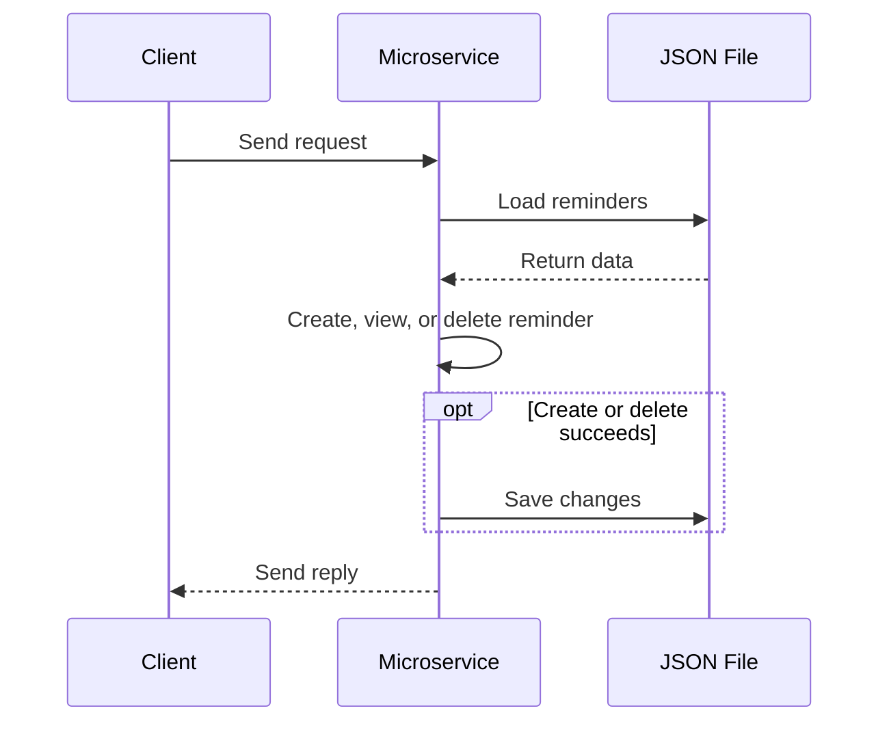

# CS361-Reminders-Scheduling
Microservice for creating, viewing, and deleting reminders.

## Description
This microservice allows applications to create reminders, view reminders, and delete reminders.
It uses Python, ZeroMQ, and JSON messages on port 5556. Reminder's are saved in `reminders_data.json` so they can be used again later.

## How to Request Data
The client sends a JSON request to the microservice using ZeroMQ.

Example of creating a reminder:

```python
import zmq

context = zmq.Context()
socket = context.socket(zmq.REQ)
socket.connect("tcp://localhost:5556")

request = {
    "action": "create",
    "app": "notepad",
    "title": "Finish homework",
    "date": "2026-11-20"
}

socket.send_json(request)
```

There are three actions available:
- `create` — Creates a reminder.
- `view` — Views saved reminders.
- `delete` — Deletes a reminder.

Example of viewing reminders:

```python
request = {
    "action": "view",
    "app": "notepad"
}

socket.send_json(request)
```

Example of deleting a reminder:

```python
request = {
    "action": "delete",
    "app": "notepad",
    "id": 1
}

socket.send_json(request)
```

The app identifies the application, title is the reminder name, date is the reminder date, and id identifies the reminder.
The date must be in YYYY-MM-DD format.
The client must receive a reply before sending another request on the same socket.

## How to Receive Data
After sending a request, the client receives the reply usig:

```python
reply = socket.recv_json()
print(reply)
```

Example reply after creating a reminder:

```json
{
    "status": "success",
    "id": 1,
    "message": "Reminder created"
}
```

Example reply after viewing reminders:

```json
{
    "status": "success",
    "reminders": [
        {
            "id": 1,
            "title": "Finish homework",
            "date": "2026-11-20"
        }
    ]
}
```

Example reply after deleting a reminder:

```json
{
    "status": "success",
    "message": "Reminder 1 deleted"
}
```

If the reminder does not exist, the microservice returns an error:

```json
{
    "status": "error",
    "message": "No reminder with id 1"
}
```

## UML Sequence Diagram



## How to Run

```bash
pip install pyzmq
```
Start the microservice:
```bash
python reminder_service.py
```
Then run the client program separately to send requests.
The microservice will keep listening for requests on port 5556 until it is stopped.
